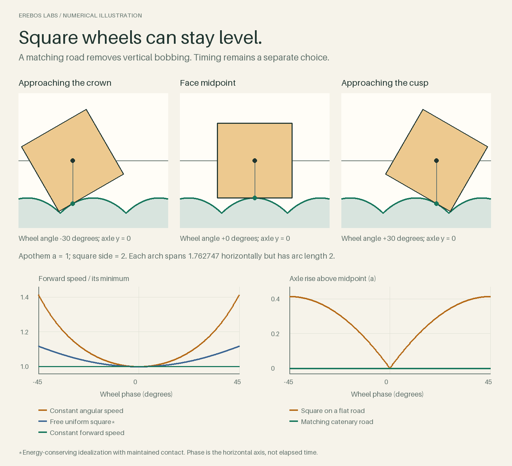
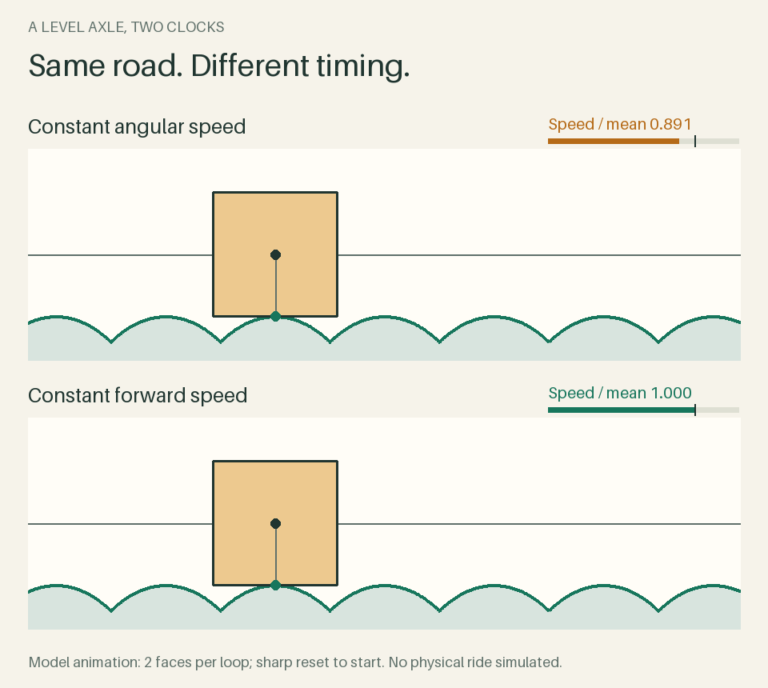
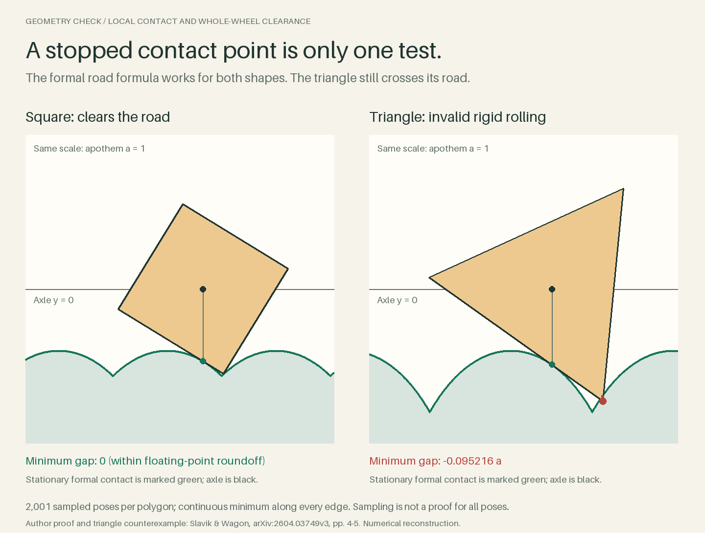

# Square wheels: level motion, variable speed

A numerical illustration from Erebos Labs, prepared with an AI assistant and checked by executable tests and visual review. No human authorship or independent human peer review is claimed. A square wheel can keep its axle level on a matching road of inverted catenary arches. That geometric property does not select a clock: holding angular speed constant produces a forward-speed range of sqrt(2), while holding forward speed constant requires variable angular speed.



## View the illustrations

- `output/level-is-not-constant-speed.png`: the matching road, speed choices and flat-road height comparison.
- `output/contact-is-not-clearance.png`: a triangular wheel can satisfy the formal local no-slip relation while another vertex penetrates its road.
- `output/two-clocks.gif`: two imposed clocks with the same road, start, finish and duration; a 120-frame, 7.2-second animation with a sharp loop reset. The differences in position are modest; the speed bars make the timing distinction clearer.

These are rendered mathematical models, not photographs, measured rides or calibrated physical simulations. All lengths use apothem 1. The regular polygons have different matching roads.



## Reproduce

The geometry and dynamics checks use Python's standard library. Figure regeneration uses Pillow 10.1 or later and its bundled default font; no external font or web asset is required. The included figures can be viewed without running code.

From this directory:

```sh
python3 probe.py
python3 dynamics.py
python3 animation_check.py
python3 figures.py
python3 verify_release.py
```

Results are written to `output/`. After changing source files or outputs, run `python3 build_release.py` to update the manifest and build a deterministic release ZIP; run `python3 verify_release.py` to check an unchanged distribution. `probe.py` uses seed 1960 for 300 segment-oracle cross-checks. `PROOF.md` supplies a separate all-pose geometric clearance argument for the square; the numerical pose sweep alone is not such a proof.

## What the calculations establish

The formal no-slip construction sets `dx/dphi = r(phi)` and places the contact point directly below the axle at `y = -r(phi)`. For one square face, `r = sec(phi)`, giving `x = asinh(tan(phi))` and the road `y = -cosh(x)`. Each arch spans 1.762747 horizontally but has arc length 2, matching the square side.



The 2,001-pose triangle sweep finds penetration of about 0.095216 apothems. Each edge minimum is continuous, but the rotation angle is sampled. The square's sampled negative gaps are only floating-point roundoff. Separate checks differentiate a frozen material point, cross-check numerical quadrature and reproduce an equal-arc-length counterexample.

An isolated, uniform filled square has `I/m = 2/3`. Conditional on energy conservation and maintained no-slip contact, its corner/mid-face forward-speed ratio is sqrt(5/4), about 1.118. This free-wheel result is different from either imposed clock. The force calculation examines one-sided requirements on smooth arches; it omits deformation, losses, rider and axle loads, and a cusp impact/contact law. It does not establish the performance or comfort of a real vehicle.

## Validation limits

The code and numerical checks were executed. Both final PNGs and a four-frame animation montage were visually reviewed. Every GIF frame was decoded, but continuous playback was not watched in a browser. No physical ride was tested. Sampling does not prove all-angle clearance, and no general frictional contact solver is included.

Two development test defects were corrected: a formatted floating-point dictionary key, and an arbitrary triangle penetration threshold that exceeded the actual result. These corrections did not alter the computed results.

## Attribution

The road construction and the local-contact/global-collision distinction are informed by Antonin Slavik and Stan Wagon, *A Minimalist Approach to Rolling Wheels*, arXiv:2604.03749v3 (14 May 2026):
https://arxiv.org/abs/2604.03749v3

The original source PDF is not bundled. This package provides original code and numerical illustrations; it does not reproduce the paper's figures. The paper is a preprint. Page 3 prints a negative inverse derivative although the page-2 theorem gives `x'(phi)=r>0`; this code follows the positive theorem relation and an independent derivation.

Additional background:
- Leon Hall, *Roads and Wheels*: https://web.mst.edu/_disabled/lmhall/Personal/RoadsWheels/roads.html
- OpenStax, *University Physics Volume 1*, 11.1 Rolling Motion, for the general rigid-body energy and static-friction framework: https://openstax.org/books/university-physics-volume-1/pages/11-1-rolling-motion

The original 1992 Hall/Wagon paper was identified in references but was not read for this reconstruction. ## Licences

Python code and `.gitignore`: **MIT**. Authored documentation and generated illustrations/results: **CC BY 4.0**, to the extent applicable rights exist. See [COPYRIGHT.md](COPYRIGHT.md), [LICENSE](LICENSE), [LICENSE-CC-BY-4.0.txt](LICENSE-CC-BY-4.0.txt) and [THIRD_PARTY_NOTICES.md](THIRD_PARTY_NOTICES.md) for exact scope, attribution and excluded third-party material.

The figures and checks are not a physical-performance guarantee. The underlying mathematics is established work.
